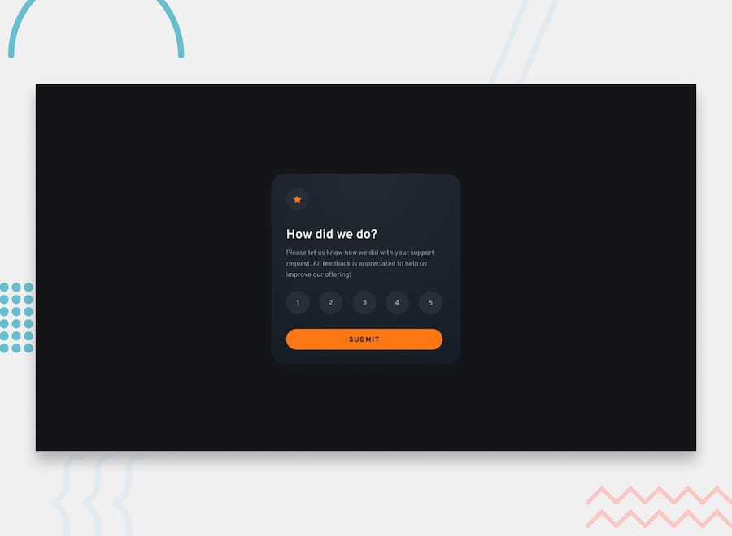
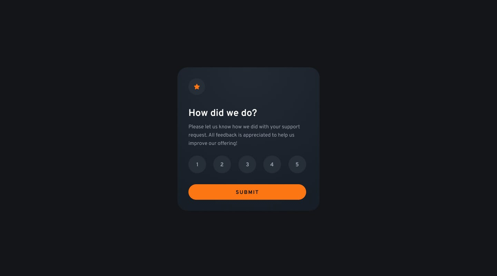

# Frontend Mentor - Interactive rating component

This is a solution to the [Frontend Mentor Interactive rating component challenge](https://www.frontendmentor.io/challenges/interactive-rating-component-koxpeBUmI).



## Overview

A small but polished feedback UI that lets users:

- choose a rating from 1 to 5
- submit their selection
- see a confirmation state with the chosen rating
- use the interface comfortably on mobile and desktop screens

The project focuses on a clean card layout, responsive behavior, subtle transitions, and a simple JavaScript interaction flow.

## Challenge requirements

Users should be able to:

- view the optimal layout for the screen size
- see hover states for interactive elements
- select and submit a rating
- confirm their rating in a thank-you state

## Screenshot



## Built with

- HTML5
- CSS3
- JavaScript (vanilla)
- Responsive design
- Accessible semantic markup

## Project structure

- `index.html` — component markup and structure
- `style.css` — layout, color system, hover states, responsiveness
- `app.js` — rating selection and submit interaction logic
- `images/` — icons and illustration assets
- `design/` — challenge reference images

## Run locally

1. Open `index.html` directly in a browser, or
2. Start a local server from the project folder:

```bash
python3 -m http.server 8000
```

Then visit `http://localhost:8000`.

## Notes

This is a front-end exercise focused on building a compact interactive component with clean UI patterns and simple state changes. The code demonstrates how to manage a selection state, display validation feedback, and transition between rating and thank-you views.

## Attribution

Challenge by [Frontend Mentor](https://www.frontendmentor.io/).  
Coded by [Ruben de Man](https://rubendeman.nl).
